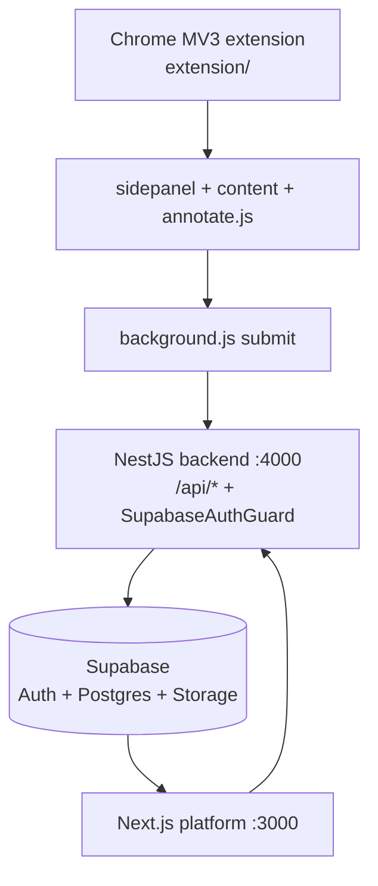
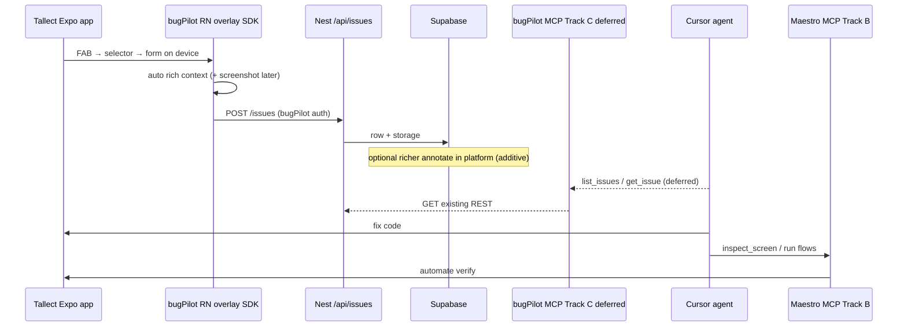

# bugPilot Mobile QA Architecture (three-track)

**Status:** Track **A** Phase 1 active (`packages/react-native` scaffold). Track **C** (MCP) deferred.  
**App under test (external):** `/Users/rahulsarawagi/TM/Tallect-Mobile` (Track B — Maestro — not this turn).  
**Last updated:** 2026-11-03.  
**Decisions:** See [Decisions log](#decisions-log-2026-11-03) — **#7 Locked**.

## Three-track split (LOCKED)

| Track | Owner | Status |
| --- | --- | --- |
| **A — RN reporter** (floating icon → select → form) | bugPilot | **Phase 1 START** — [TRACK_A_PHASE1.md](./TRACK_A_PHASE1.md) |
| **B — Maestro / testIDs / journeys** | Tallect | Parallel — not started this turn |
| **C — bugPilot MCP** read-only | bugPilot | **Deferred** separate task |

## What already exists (web)

| Layer | Path | Role |
| --- | --- | --- |
| Extension | `extension/` | Hover/click capture, annotation canvas, rrweb/video, buffer, submit |
| Backend | `backend/src/` | Issues, projects, workspaces, integrations, AI helpers |
| Platform | `platform/` | Dashboard, issue detail, replay/video players, settings |
| Auth | Supabase JWT | `supabase.auth.getUser(token)` on Nest routes |
| Storage | Supabase private buckets | Screenshots, replays, videos (signed URLs on read) |

**Issue create (extension → API):** `POST ${API_URL}/api/issues` with Bearer user JWT; payload maps title, description, severity, url, route, browser_info, element_info, base64 screenshots, metadata, optional replay ([Certain] — `extension/background.js` submit path).

**List / get:** `GET /api/issues/project/:projectId`, `GET /api/issues/:id` ([Certain] — `issues.controller.ts`).

**Web capture UX (parity target):** Activate reporting → hover/click element → modal form (smart AI or standard) → auto-attach element + page context → optional annotate canvas → submit ([Certain] — `content.js` + `annotate.js`).

## What does **not** exist

| Gap | Confidence |
| --- | --- |
| React Native / Expo reporter package | Track A Phase 2 under `packages/react-native` (FAB/select/form + view-shot adapter; Tallect install gated) |
| Product MCP server for Cursor to list/fetch bugs | Certain — still absent; Track C deferred (not built this turn) |
| First-class `platform: mobile` / device metadata columns | Likely — `CreateIssueDto` is web-oriented; `metadata` is open `Record` so mobile fields can start there without migration |

## Locked capture surface: in-app overlay

**Locked (2026-11-03):** Option A — in-app overlay inside the host RN app (Tallect first).

Product flow (**#7 Locked** — parity with Chrome extension form/select behavior, mobile entry chrome):

1. User taps **free-floating icon** (FAB) → enables **selector mode**.
2. User **selects an element** (tap target / highlight overlay).
3. **Form opens on device** the same way as the extension modal (Smart / Standard field concepts) — **not** “edit only after upload.”
4. SDK **automatically attaches rich context** (route, testID/a11y/opt-in name, device; screenshot via interface — may need native approval).
5. Submit → same `POST /api/issues` family as the extension.

Rejected for v1 primary path: companion app, Metro/desktop sidecar — may revisit only if overlay is blocked by native-dep policy.  
Optional richer platform editing after upload is **additive**, not a substitute for on-device form.

## Package recommendation (SDK vs script)

### Existing packaging patterns ([Certain])

| Area | Layout | Notes |
| --- | --- | --- |
| Root | `package.json` name `node-starter` — **not** an npm workspaces monorepo | Sibling apps, not a published package graph |
| `backend/` | NestJS own `package.json` | API |
| `platform/` | Next.js own `package.json` | Dashboard |
| `extension/` | Vanilla MV3 JS folder (no npm package publish) | Load unpacked |
| `justhustle/`, `mimik/` | Separate trees | Unrelated to reporter SDK |
| `packages/` | **Does not exist** | No prior RN/shared lib workspace |

### Recommendation — **reusable RN library** (not a one-off Tallect script)

| Choice | Verdict |
| --- | --- |
| **Prefer** | New folder **`packages/react-native`**, publishable name **`@bugpilot/react-native`** (or `bugpilot-react-native` if scoped npm not ready). Consumable by Tallect and other Expo/RN apps. |
| **Acceptable fallback** | Thin script / copy-paste module **only** if v1 must ship without packaging — clearly harder for overlay + auth + multi-app reuse; avoid unless forced. |
| **MCP** | Separate package e.g. `packages/mcp-server` (stdio wrapper over REST) — not inside the RN package. |

**Rationale:** Overlay + element selection + context collectors + auth client + issue POST is product surface, not a 20-line helper. Web already ships as a dedicated `extension/` product; RN should be a dedicated installable package for the same reason. Root is not workspaces yet — introduce `packages/` as the first shared publishable libs (RN + MCP), without requiring a full Turborepo migration in Phase 0/1 design.

**Tallect consumption:** install/link later with explicit user approval + native-dep check (Tallect `native-dev-workflow.mdc`). Auth tokens come from **bugPilot-designed** auth — Tallect does not invent JWT/PAT.

## Target dual-repo flow

## Two Cursor MCP servers (do not conflate)

| MCP | Owner | Track | Status |
| --- | --- | --- | --- |
| **Maestro MCP** | Maestro CLI (`maestro mcp`) | B (Tallect) | Not started this turn |
| **bugPilot MCP** | This product | C | **Deferred** — read-only when started; do not implement in Track A |

Do not invent Maestro tool names — official docs only. bugPilot tool names stay proposed until Track C (`MCP_SERVER.md`).

## Web → RN capture mapping

Mapped from web `extension/content.js` (`captureElementData`, `capturePageContext`, `extractDOMContext`, `getReactComponentInfo`) + submit in `background.js`. Confidence tags: **[Certain]** = exists in web today; RN column = design target honesty.

### Product flow

| Web (today) | RN (target) | Notes |
| --- | --- | --- |
| Side panel “Capture Now” / ⌥⇧Q → start reporting | **Free-floating icon** → enable selector mode | **#7 Locked** — mobile entry chrome differs; behavior matches |
| Hover highlight + click element | Tap / press to select view | No DOM hover; use RN touch overlay |
| Modal form (Smart Mode + Standard Form) | On-device form — **same field concepts** | **#7 Locked** — not upload-only edit |
| `annotate.js` canvas (rect/arrow/blur/…) | Optional later; platform edit after upload is additive | **#7 Locked** — form+select on device is v1 |
| Buffer / batch submit | TBD v1 (single-issue first OK) | Web has buffer-first |

### Element / identity context

| Web field / capability | RN analogue | Feasibility |
| --- | --- | --- |
| `data-testid` / `data-cy` / `data-qa` | **`testID`** (and a11y `nativeID` / label) | **High** — preferred selector; Tallect has **none** today |
| CSS selector / XPath (`finder.js`) | N/A | No DOM. Prefer testID + component path |
| Tag / id / classList / text | View type, `testID`, accessibility label, truncated text | **Medium** via host props / measure |
| Bounding box / dimensions / click coords | `measureInWindow` / touch coords | **High** |
| Accessibility attrs | RN accessibility props | **High** |
| DOM breadcrumb / container / siblings (`extractDOMContext`) | Parent `testID`s / screen section labels | **Medium** — explicit instrumentation helps |
| React Fiber (`__reactFiber$` → componentName, tree, props, `_debugSource`) | **Do not rely on Fiber/DevTools internals** | **Low / risky** — private APIs, break across RN versions, Hermes, release builds. Prefer: optional `displayName` passed by wrapper, React Navigation route names, explicit `bugpilotName` / testID conventions. Dev-only DevTools bridges are unsupported product APIs. |

### Page / app / environment context

| Web | RN | Feasibility |
| --- | --- | --- |
| `location.pathname` / hash / query | React Navigation **route name** + params (sanitize secrets) | **High** if SDK receives navigation ref / listener |
| `document.title` | Screen title / header options if available | **Medium** |
| `browser_info` / UA / OS | `Platform.OS`, OS version, device model, app version, bundleId, Expo SDK, `isDevClient` | **High** |
| Console errors | Metro / LogBox / patched `console` buffer (dev) | **Medium** — PII careful |
| Network transactions | Fetch/XHR interceptor (optional) | **Medium** — must sanitize Authorization (web already does) |
| rrweb replay | N/A — optional short video / step log later | Phase 3 |
| App state (router/Zustand probes) | Explicit nav state snapshot only | **Prefer supported** APIs over memory probes |

### Media

| Web | RN | Feasibility |
| --- | --- | --- |
| Element + full screenshots | Full window / selected region capture | Needs approved capture approach (e.g. view-shot style) — **native dep approval in Tallect** |
| Annotated PNG | On-device form+context first; light markup / platform edit additive | **#7 Locked** — needs native screenshot approval |

### Honest risks

1. **Fiber / DevTools:** Web Fiber walk is already brittle; RN equivalent is worse. Treat component name as best-effort only when host opts in.
2. **Release builds:** Overlay should gate on `__DEV__` or explicit QA build flavor — product decision for Tallect wire-up.
3. **Native modules:** Screenshot/overlay may trigger Tallect native rebuild — never install without user approval.
4. **Parity ≠ clone:** Same *product behavior* (select → form → rich context → API), not a DOM/CSS/XPath clone.

## Reuse vs new

| Capability | Reuse | New for mobile |
| --- | --- | --- |
| Auth | Nest guards / Supabase patterns | **bugPilot designs** JWT vs PAT for RN + MCP; Tallect consumes |
| Projects / workspaces | Existing CRUD | Project tagging for “Tallect Mobile” |
| Issue create/list/get | Existing REST | `metadata.device` / RN route naming conventions |
| Screenshots | Storage upload path | Capture API on device |
| Annotation canvas | Web `annotate.js` inspiration | Form+select on device (#7); light tools / platform post-upload additive |
| rrweb | Web DOM | N/A on RN — video / step log instead |
| MCP for Cursor | — | Track C deferred — stdio wrapper over REST later |
| Maestro | — | Track B — lives in **Tallect** + Maestro CLI MCP; not bugPilot |

## Decisions log (2026-11-03)

| # | Topic | Decision | Status |
| --- | --- | --- | --- |
| 1 | RN capture surface | Floating icon → select → form → auto context. Parity with web extension behavior. | **Locked** |
| 2 | SDK vs script | Prefer reusable `@bugpilot/react-native` under `packages/react-native`. | **Locked** (prefer package) |
| 3 | Auth (reporter + MCP) | Owned by bugPilot (JWT vs PAT internal). Consumers only plug in what SDK/MCP provide. | **Locked** |
| 4 | Maestro MCP | Separate Cursor server (Track B / Tallect). Official Maestro docs. | **Locked** |
| 5 | Screenshot / AI privacy | Owned by bugPilot. | **Locked** |
| 6 | Entra / Maestro login (Tallect) | Credentials via env / Maestro env / local untracked — never commit. | **Locked** (pattern; Tallect-side) |
| 7 | Annotation / on-device | **Free-floating icon → selector mode → form opens same as Chrome extension.** On-device capture — **not** “edit only after upload.” | **Locked** |
| 8 | Tallect flow folder | Default `.maestro/` (Tallect). | **Locked** (default; Tallect) |
| 9 | Workstream split | Track A separate from Tallect product features and from MCP. | **Locked** |
| 10 | MCP near-term | Deferred separate task; read-only (list/get) when started. | **Locked** |
| 11 | Track A Phase 2 go | User chose **A = Track A Phase 2** (continue RN reporter). No Track B/C this turn. Screenshot = optional peer `react-native-view-shot`; Tallect install blocked until explicit approval. | **Locked** (2026-11-03) |

## Inspired by Jelly (not a dependency)

bugPilot’s RN capture UX is **inspired by** Jelly (toolbar → annotate/bug mode → element select → form → agent-ready screenshot + hierarchy/source context). It is **not** a Jelly integration.

| Lock | Detail |
| --- | --- |
| Reference | Marketing: [addjelly.com](https://addjelly.com/); technical: [jelly-android](https://github.com/rajanndube/jelly-android) |
| License | PolyForm Shield 1.0.0 — **do not** copy/vendor their code into bugPilot; independent implementation only |
| RN reality | jelly-android cannot see RN bridge UI; Jelly’s RN client is marketed separately and was unpublished on npm at research time — we still build our own package |
| Sync model | Jelly’s “MCP” = HTTP `/sessions` + optional `jelly-local-sync`. Cursor path here remains **bugPilot MCP** over existing Nest REST — do not clone Jelly’s wire protocol |
| Docs | [JELLY_PARITY.md](./JELLY_PARITY.md) · Tallect [QA/JELLY_REFERENCE.md](/Users/rahulsarawagi/TM/Tallect-Mobile/QA/JELLY_REFERENCE.md) |

## Relation to Tallect docs

App-side plan and Maestro ownership:  
`/Users/rahulsarawagi/TM/Tallect-Mobile/QA/`
